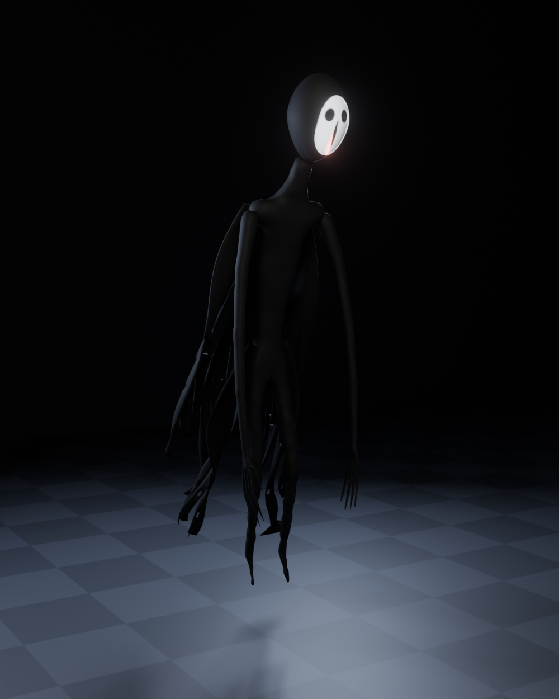
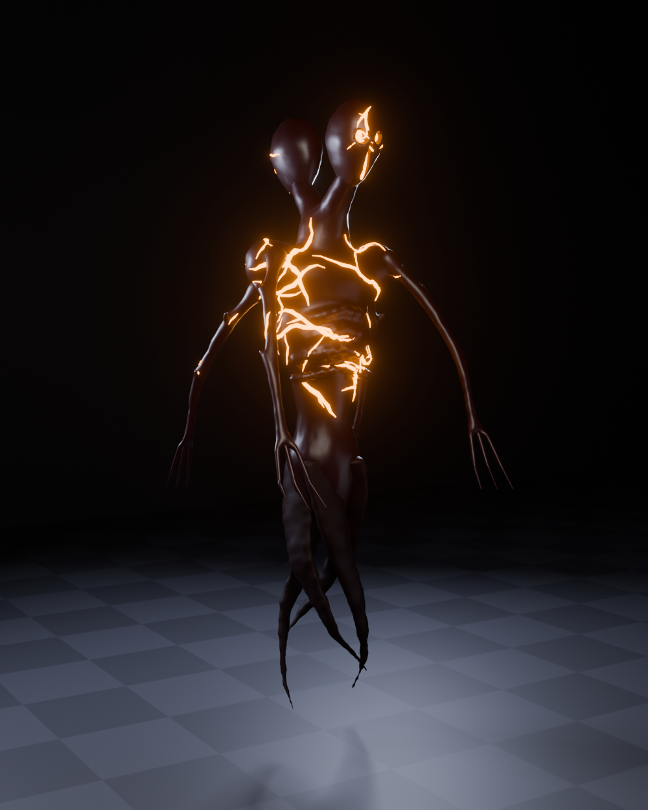
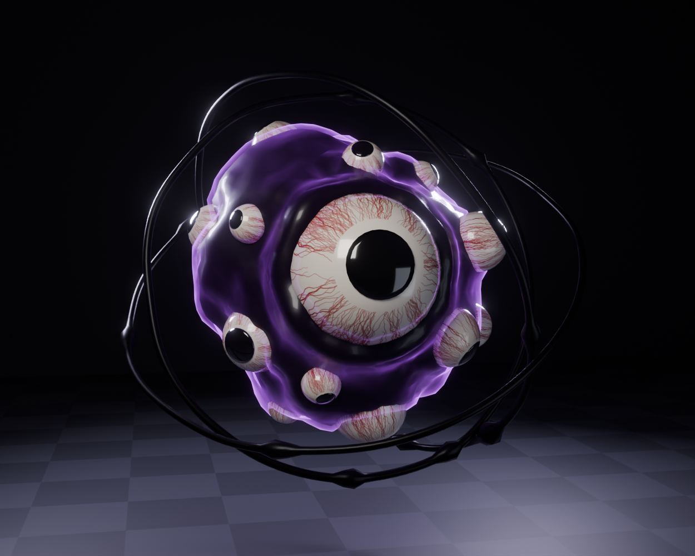

# Canavarlar (Roblox)

Blender'da prosedürel olarak üretilmiş üç canavar. Her canavarın kendi klasöründe
`.blend` (düzenlenebilir kaynak), `.fbx` (Roblox'a aktarılacak dosya) ve
`renders/` (kontrol ekran görüntüleri) bulunur. Ölçek: **1 Blender birimi = 1 stud**.

| Canavar | Ölçü | Parçalar |
|---|---|---|
| **Fısıltı** (`Fisilti/`) | 9 stud boy, yerden 1 stud yukarıda süzülür | Root, Govde, Bas, Yuz, Agiz, SolKol, SagKol, Pelerin1-6 |
| **Geri Dönen** (`GeriDonen/`) | 10 stud boy, yerden 0.5 stud yukarıda | Root, Govde, BasOn, BasArka, Kol1-4, Kuyruk1-4, Catlaklar |
| **Bakan** (`Bakan/`) | 6 stud çaplı göz kümesi (+ halkalar) | Root, AnaGoz, AnaIris, KucukGoz1-15, Iris1-15, Kutle, Parilti, Halka1-3 |

İstenen listeye eklenen iki parça var. Roblox'ta bir MeshPart tek renk/tek
materyal taşıyabildiği için bunlar ayrı parça olmak zorunda:

- **Fisilti/Agiz**: ağız yarığının içindeki soluk kırmızı Neon ışık. Beyaz yüz
  (Yuz) ile aynı parçada olamaz.
- **Bakan/Parilti**: kütleyi saran, çok saydam mor Neon hale. Bu "hafif mor
  Neon glow" etkisini verir.

## Görüntüler

| Fısıltı | Geri Dönen | Bakan |
|---|---|---|
|  |  |  |

Diğer açılar (yan, arka, yakın çekim, yanında 5 studluk R6 "noob" ile ölçek)
her klasörün `renders/` dizininde.

## Roblox'a aktarma

1. Roblox Studio'da **Avatar → Import 3D** (veya **File → Import 3D**) ile
   `Fisilti/Fisilti.fbx` dosyasını seç. Diğer ikisi için de aynısını yap.
   - Parçalar ayrı kalmalı, *merge meshes* gibi birleştirme seçeneklerini açma.
   - Model Workspace'e `Fisilti` / `GeriDonen` / `Bakan` adıyla gelir. Adı değiştirme.
2. **View → Command Bar**'ı aç, [`RobloxKurulum.lua`](RobloxKurulum.lua) dosyasının
   tamamını yapıştır ve **Enter**'a bas. Betik Workspace'te bulduğu her canavar için:
   - importer'ın iç içe koyduğu parçaları düzleştirir, eksik parça varsa Output'a yazar,
   - boyu Blender'daki ölçüye getirir (importer birim ayarı ne olursa olsun),
   - `Root`'u görünmez, Anchored ve `PrimaryPart` yapar. Root'un LookVector'u
     canavarın önüne bakar (Fısıltı'da yüz, Geri Dönen'de BasOn, Bakan'da AnaGoz),
   - renk ve materyalleri ayarlar (Yuz, Agiz, Catlaklar ve Parilti **Neon**),
   - tüm parçaları `WeldConstraint` ile Root'a bağlar,
   - modeli **`ReplicatedStorage/Assets/Monsters/<Ad>`** konumuna taşır.
     İstersen betiğin başındaki `HEDEF_SERVIS` satırını `ServerStorage` yap.

Betik canavara özel şunları da ekler:

- **Fısıltı**: Govde'ye `IzUst` / `IzAlt` Attachment'ları ve aralarına siyah bir
  **Trail** (`SiyahIz`, ömrü 0.6 sn). Koridor boyunca hızla geçerken arkasında
  siyah iz bırakır. Ayrıca yüz ve ağız için zayıf PointLight'lar ve gövdeden
  sızan siyah duman.
- **Geri Dönen**: gövdede turuncu PointLight'lar, kuyruktan aşağı süzülen duman.
- **Bakan**: her iris kendi gözüne bir `Motor6D` (`IrisMotor`) ile, her halka
  Root'a bir `Motor6D` (`HalkaMotor`) ile bağlanır. Modele `BakanBakis` adlı,
  `RunContext = Client` bir Script eklenir. Bu script irisleri yerel oyuncunun
  kafasına çevirir (en fazla ~30°; her oyuncu gözlerin **kendisine** baktığını
  görür) ve halkaları yavaşça döndürür. Root'a mor bir PointLight da eklenir.

Betiği tekrar çalıştırmak güvenlidir: önce kendi eklediklerini siler, sonra yeniden kurar.

### Oyunda kullanma

```lua
local sablon = game.ReplicatedStorage.Assets.Monsters.Fisilti
local canavar = sablon:Clone()
canavar.Parent = workspace

-- Root merkezinin zeminden yüksekliği; Fısıltı'yı yerden 1 stud yukarıda tutar
local yukseklik = canavar:GetAttribute("RootYerdenYukseklik")
canavar:PivotTo(CFrame.new(0, zeminY + yukseklik, 0))

-- Hareket: Root anchored, PivotTo / TweenService ile taşı. Trail kendiliğinden iz bırakır.
```

İpucu: Neon parçaların parlaması için `Lighting` altında bir `BloomEffect`
(Intensity ~1, Size ~24, Threshold ~0.9) kullan.

## Modelleri yeniden üretme

Modeller `_blender/` altındaki Python betikleriyle üretiliyor (Blender 5.2):

```bash
pip install bpy==5.2.2                 # Blender'ı Python modülü olarak kurar
python _blender/build_all.py           # üçü birden: .blend + .fbx + renders
python _blender/fisilti.py --preview   # tek canavar, hızlı düşük kalite render
```

Betikler Blender'ın içinden de çalışır: `blender -b -P _blender/fisilti.py`.
Ölçüler (boy, süzülme yüksekliği, çap) her betiğin başındaki sabitlerde.
`Bakan/BakanGozDamar.png` göz akı dokusu (kırmızı damarlar) da betik tarafından
üretilir ve FBX'in içine gömülür. Import 3D dokuyu getirmezse bu PNG'yi
AnaGoz/KucukGoz parçalarına `TextureID` veya `SurfaceAppearance` olarak elle ekleyebilirsin.
