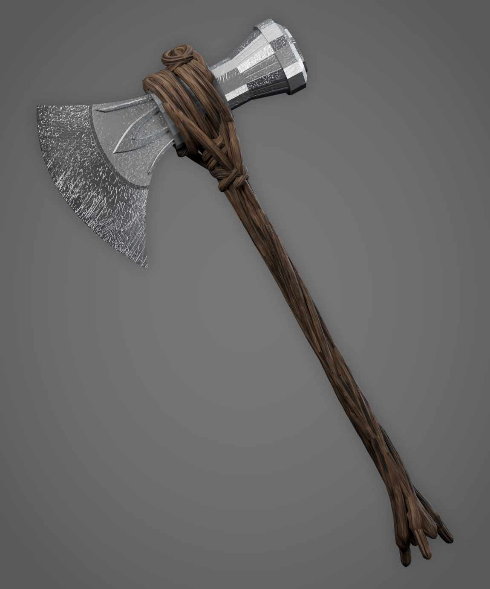

# Stormbreaker (Fırtınakıran): Roblox Modeli

Blender'da baştan sona prosedürel olarak yapıldı: geometri, UV, PBR dokular ve render'lar
`src/stormbreaker_build.py` script'iyle üretiliyor.



## Dosyalar

| Dosya | Ne işe yarar |
|---|---|
| `Roblox/Stormbreaker.fbx` | **Studio'ya bunu içe aktar.** İki MeshPart içerir: `Stormbreaker_Head` (metal baş) ve `Stormbreaker_Handle` (ağaç kökü sap). |
| `Roblox/Stormbreaker_Tool.rbxm` | Hazır **Tool**: tutuş (Grip), otomatik kaynak/kurulum script'i, SurfaceAppearance yuvaları. |
| `Roblox/Stormbreaker.glb` | Aynı model glTF olarak, PBR dokular içine gömülü (alternatif). |
| `Roblox/Textures/*_1024.png` | SurfaceAppearance için 1024×1024 PBR haritaları (Color / Normal / Roughness / Metalness). |
| `Blender/Stormbreaker.blend` | Blender kaynak dosyası (dokular içinde paketli, açıp düzenleyebilirsin). |
| `Textures/*.png` | 2048×2048 kaynak dokular. |
| `Previews/` | Render fotoğrafları ve 360° dönen GIF. |

**Poligon sayısı:** Baş yaklaşık 4,6 bin, sap yaklaşık 18,5 bin üçgen. İkisi de Roblox'un MeshPart başına 20 bin sınırının altında.
**Boyut:** Toplam yaklaşık 4,9 stud boy, başın genişliği yaklaşık 2,4 stud.

## Studio'ya ekleme

1. **Home → Import 3D** ile `Roblox/Stormbreaker.fbx` dosyasını seç.
   *Scale Unit:* **Stud**, *World Forward:* **Front**, *World Up:* **Top** olmalı.
   Import'a bas. Workspace'e iki MeshPart'lı bir Model gelir.
2. **Dokular (en güzel görünüm için SurfaceAppearance):**
   1. `Roblox/Textures` içindeki 8 PNG'yi yükle: *View → Asset Manager → Bulk Import*.
   2. `Stormbreaker_Head` MeshPart'ının içine **SurfaceAppearance** ekle:
      - `ColorMap`: `Head_Color_1024`
      - `NormalMap`: `Head_Normal_1024`
      - `RoughnessMap`: `Head_Roughness_1024`
      - `MetalnessMap`: `Head_Metalness_1024`
   3. `Stormbreaker_Handle` için de aynısını `Handle_*` dosyalarıyla yap.
   4. MeshPart'ların `TextureID` alanını boş bırakabilirsin. SurfaceAppearance onu geçersiz kılar.
3. **Elde tutulan Tool (hazır .rbxm):**
   1. `Roblox/Stormbreaker_Tool.rbxm` dosyasını Studio'ya sürükle, çıkan **Stormbreaker** Tool'unu **StarterPack**'e koy.
   2. Import 3D ile gelen Model'i (ya da içindeki iki MeshPart'ı) bu Tool'un içine sürükle.
   3. Tool içindeki `SurfaceAppearances/Head` ve `SurfaceAppearances/Handle` için haritaları Properties'ten seç.
      (2. adımdaki dokular; ya da SurfaceAppearance'ları doğrudan MeshPart'ların içine koy.)
   4. Bitti. Oyun başlayınca `StormbreakerSetup` script'i şunları kendisi yapar:
      - Sap parçasının adını `Handle` yapar,
      - Başı sapa kaynaklar,
      - Anchored, CanCollide ve Massless ayarlarını yapar,
      - Görünümleri (SurfaceAppearance) parçalara takar.
   5. Tutuş `Grip` ile ayarlı: el sapın alt üçte birini tutar, ağız kesme yönüne bakar.
      Beğenmezsen Tool'un `GripPos` / `GripUp` / `GripForward` değerlerini değiştir.

> Neden model `.rbxm`'in içinde değil: Roblox'ta bir MeshPart'ın şekli Roblox'a yüklenmiş bir
> mesh asset'i olmalı. `.rbxm` dosyası mesh verisini taşıyamaz, bu yüzden model FBX ile Import 3D'den
> gelir (Studio otomatik yükler). Tool ve script'leri ise `.rbxm` içinde hazır.

## Yeniden üretmek ya da değiştirmek

```bash
pip install bpy numpy pillow scipy        # Python 3.13
python3.13 src/stormbreaker_build.py -- .            # tam kalite (2048 doku, yüksek örnekli render, GIF)
python3.13 src/stormbreaker_build.py -- . --fast     # hızlı önizleme
```

`stormbreaker_build.py` içindeki şu değerlerle şekli kolayca değiştirebilirsin:

- `E0 / E1 / E2`: ağzın kesici kenar eğrisi
- `PLATES`: yanaktaki kabartma desenleri
- `HAMMER_SECTIONS`: çekiç kısmının kesitleri
- `ZH` ve `_RR`: sap uzunluğu ve kalınlığı
