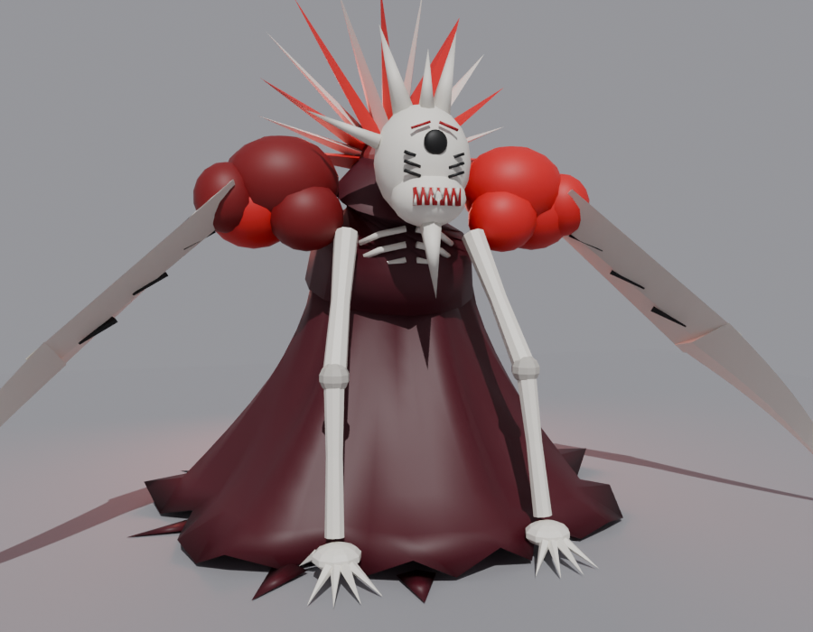

# Yami Sukehiro – Karanlık Büyü Yetenek Seti (Roblox)

Black Clover'daki Yami'nin karanlık büyüsünden esinlenen, tamamı **simsiyah** efektlerle çalışan bir yetenek seti.
Animasyonlar ve VFX meshleri Blender'da yapıldı. Script'ler hazır `.rbxm` dosyaları olarak geliyor.


---

## 1. Yetenekler

| Tuş | Yetenek | Ne yapar | Bekleme |
|---|---|---|---|
| **Sol tık** (mobilde dokun, gamepad R2) | Kılıç Kombosu | 4 vuruşluk katana kombosu. Her vuruşta siyah hilal iz. 4. vuruş havadan inip yeri çatlatır ve hedefi fırlatır. | – |
| **Z** | Kara Hilal (*Kokugetsu*) | Geniş yatay kesik; ileri uçan dev siyah hilal. Yolundaki herkesi deler, yerde kesik izi ve taş bırakır. | 6 sn |
| **X** | Ölüm Saplaması (*Shitotsu*) | Geri çekilip ileri atılır, siyah gölge-izler bırakır, değdiği herkesi delip geçer. | 8 sn |
| **C** | Kara Koza (*Ankoku Mayu*) | Etrafında dikenli karanlık bir küre oluşur (hasar almazsın), sonra patlar: krater, uçan taşlar, savurma. | 14 sn |
| **V** | **Boyut Kesiği** (*Yami Matoi: Jigen Giri*) | İai duruşunda şarj olur (ekran kararır, kayalar yerden kopup havada süzülür, toprak çatlar), sonra tek bir dev kesik: gökyüzünde **boyutu yırtan siyah yarık** açılır, ekranı boydan boya kesen çizgi, manga darbe kareleri, güçlü ekran sarsıntısı. Önündeki yer 150 stud boyunca yarılır, kayalar ve düşmanlar **havaya uçar**. | 22 sn |
| **F** | Kara Kılıç (*Yami Matoi: Kokutō*) | Katanayı karanlıkla kaplar (siyah aura + iz). 12 sn boyunca tüm hasar ×1.35. | 25 sn |

HUD'daki kutulara tıklayarak/dokunarak da yetenek kullanabilirsin (mobil uyumlu).

### Hareket (TPS kontrolleri)

| Tuş | Ne yapar |
|---|---|
| **Shift** (basılı tut) | Hızlı koşu (16 → 30 hız). Blender'da yapılmış **koşu animasyonu** oynar, herkes görür. Görüş açısı hafif açılır. |
| **Ctrl** (aç/kapa) | **Nişan kilidi**: fare ekranın ortasına kilitlenir, kamera omuz üstüne kayar, karakter hep kameranın baktığı yöne döner, ortada nişangâh çıkar. Yetenekler nişangâhın yönüne atılır. |

Mobilde ekranda **KOŞ** ve **NİŞAN** butonları çıkar. Roblox'un kendi *Shift Lock* özelliği Shift'i çalmasın diye
kapatılır (`Config.Movement.DisableDefaultShiftLock`).

### Boss: Kızıl Kemik İblisi



Resimdeki gibi: beyaz kemik maske (tek siyah göz, boynuzlar, dişli ağız), arkasında kırmızı/beyaz diken taç, kırmızı
kaslı omuzlar, yere uzanan dev beyaz bıçak kollar, bordo yırtık pelerin. Modeli, rigi ve 7 animasyonu Blender'da
yapıldı (`Blender/YamiBoss.blend`). Oyunculara yürür ve saldırır; **hasarları bilerek çok düşük** (2–5).

| Saldırı | Ne yapar | Hasar |
|---|---|---|
| Kesik (yakın) | Sağ bıçakla önünü süpüren dev kırmızı hilal | 3 |
| Yere Vuruş | İki bıçağı kaldırıp önüne çakar; yerde kırmızı uyarı çemberi, krater, uçan taşlar | 5 |
| Atılma (orta) | Eğilip ileri fırlar, kırmızı gölge-izler | 4 |
| Kükreme (uzak) | Taçtan kırmızı enerji patlar, yakındakileri iter; birkaç saniye sonra **oyuncuların altından dikenler fışkırır** (uyarı çemberinden kaç!) | 2 |

- Can: 3000 (ekranın üstünde can barı). Ölünce dağılır, 25 sn sonra yeniden doğar.
- Senin yeteneklerin ona işler (itme direnci var, sersemleme kısa sürer).
- Nerede doğacağı: Workspace'e **YamiBossSpawn** adında bir Part koy (boss onun baktığı yöne bakar). Yoksa `Config.Boss.SpawnPosition`.
- Ayarlar: `Config.Boss` (can, hız, menzil, her saldırının hasarı/bekleme süresi). Kapatmak için `Enabled = false`.

---

## 2. Paket içeriği

```
YamiSkills/
├─ KURULUM.md                       ← bu rehber
├─ Roblox/
│  ├─ 1_ReplicatedStorage_YamiSkills.rbxm         ← modüller, ayarlar, animasyonlar, katana Tool'u
│  ├─ 2_ServerScriptService_YamiSkillsServer.rbxm ← sunucu script'i
│  ├─ 3_StarterPlayerScripts_YamiSkillsClient.rbxm← istemci (LocalScript)
│  └─ YamiSkills_Demo.rbxl                        ← hazır demo yer (aç → Play)
├─ Blender/
│  ├─ YamiVFX.blend                  ← tüm VFX meshleri + katana + kılıf (kaynak)
│  ├─ YamiRig_Animations.blend       ← R15 rig + 12 animasyon (koşu dahil) + Roblox exporter
│  ├─ YamiBoss.blend                 ← boss modeli + rig + 7 animasyon + exporter
│  ├─ Meshes/*.fbx                   ← Roblox'a aktarılacak meshler
│  ├─ Textures/*.png                 ← dokular (T_ = mesh, P_ = parçacık)
│  └─ Sounds/*.ogg                   ← isteğe bağlı özel ses efektleri
├─ Previews/                         ← animasyon GIF'leri + mesh önizlemesi
└─ src/                              ← kaynak kod (Luau + Blender Python + Rojo projeleri)
```

---

## 3. En hızlı deneme: Demo yeri

1. Roblox Studio'da `Roblox/YamiSkills_Demo.rbxl` dosyasını aç (File → Open from File).
2. **Play** (F5).
3. Envanterden **Yami Katana**'yı seç (1 tuşu). Katana kalçadaki kılıftan çekilir.
4. Sol tık = kombo, **Z X C V F** = yetenekler. Mankenleri ve sandıkları dene.

---

## 4. Kendi oyununa ekleme (3 dosya)

> **Zorunlu:** Oyun **R15** olmalı → *Home → Game Settings → Avatar → Avatar Type: R15*.

1. **Explorer**'da `ReplicatedStorage`'a sağ tık → **Insert from File…** → `1_ReplicatedStorage_YamiSkills.rbxm`
   → `ReplicatedStorage` içinde **YamiSkills** klasörü oluşur.
2. `ServerScriptService`'e sağ tık → **Insert from File…** → `2_ServerScriptService_YamiSkillsServer.rbxm`
   → **YamiSkillsServer** (Script) oluşur.
3. `StarterPlayer > StarterPlayerScripts`'e sağ tık → **Insert from File…** → `3_StarterPlayerScripts_YamiSkillsClient.rbxm`
   → **YamiSkillsClient** (LocalScript) oluşur.
4. **Play**. Katana herkese otomatik verilir (istemezsen `Config.GiveKatanaToEveryone = false` yap ve
   `ReplicatedStorage.YamiSkills.Assets.YamiKatanaTool`'u kendin ver).

Doğru kurulum Explorer'da şöyle görünür:

```
ReplicatedStorage
└─ YamiSkills
   ├─ Config            ← AYARLAR (tuş, hasar, cooldown, ID'ler)
   ├─ Animations        ← 11 KeyframeSequence (Blender'dan)
   ├─ Assets
   │  ├─ Meshes         ← Blender meshlerini buraya koy
   │  └─ YamiKatanaTool
   ├─ Remotes
   └─ AnimPlayer, CameraShake, HUD, KatanaRig, RockFX, ScreenFX, SFX, SkillFX, Util, VFX
ServerScriptService
└─ YamiSkillsServer (Combat, Skills)
StarterPlayer
└─ StarterPlayerScripts
   └─ YamiSkillsClient
```

> İpucu: `.rbxm` dosyasını Studio penceresine sürükleyip bırakırsan Workspace'e düşer; sonra Explorer'da doğru yere taşı.

Bu kadar – **meshleri ve animasyonları yüklemesen de sistem çalışır** (aşağıya bak).

---

## 5. Blender VFX meshlerini ekleme (önerilir)

Mesh yokken efektler aynı şekilde Part'larla çizilir; meshlerle çok daha güzel görünür.

1. Studio → **Home** (veya **Avatar**) sekmesi → **Import 3D**.
2. `Blender/Meshes/YamiVFX_AllMeshes.fbx` dosyasını seç.
3. Ayarlar: *File Dimensions → Scale Unit:* **Stud**, *World Forward:* **Front**, *World Up:* **Top** (varsayılanlar genelde böyledir).
4. **Import** → Workspace'e `YamiVFX_AllMeshes` adlı bir model gelir.
5. Bu modeli `ReplicatedStorage > YamiSkills > Assets > Meshes` içine sürükle. (İçindeki MeshPart'ların
   adlarını değiştirme: `SlashArc, DimensionRift, ShockRing, Swirl, Cocoon, Rock1, Rock2, Rock3, Shard, ImpactStar, Katana, KatanaSaya`.)
6. Play → hilal kesikler, boyut yarığı, koza, kayalar ve **Blender'daki katana + kılıf** artık mesh olarak görünür.
7. **Boss için de aynısı:** `Blender/Meshes/YamiBoss_Parts.fbx`'i Import 3D ile aktar, oluşan modeli yine
   `Assets > Meshes` içine sürükle (parçalar `Boss_Pelvis, Boss_Head, Boss_Crown, Boss_BladeR` … adında).
   Boss bundan sonra doğduğunda resimdeki görünümle çıkar. Mesh yokken aynı iskelet basit parçalarla
   (top, bıçak, kemik, dikenler) kurulur, animasyonlar yine çalışır.

Bir mesh ters/yan dönük görünürse `Config.MeshRotation` içinden derece ver (örn. `SlashArc = Vector3.new(0, 180, 0)`).

---

## 6. Animasyonlar

Blender'da yapılan animasyonlar `YamiSkills/Animations` içinde **KeyframeSequence** olarak geliyor:
- Oyuncu (R15): `Hold, Equip, M1_1, M1_2, M1_3, M1_4, BlackMoon, DeathThrust, BlackCocoon, DimensionSlash, BlackBlade, Run`
- Boss: `Boss_Idle, Boss_Walk, Boss_Slash, Boss_Slam, Boss_Lunge, Boss_Roar, Boss_Death`

**Yükleme yapmadan çalışır:** `Config.AnimationIds` boşken dahili oynatıcı KeyframeSequence'ları
doğrudan oynatır (Studio'da da yayınlanmış oyunda da; herkes birbirinin animasyonunu görür).

**İstersen Roblox'a yükle (resmi Animator ile oynatmak için):**
1. Explorer'da `YamiSkills > Animations > (örn.) DimensionSlash`'e sağ tık → **Save to Roblox…**
   (Grup oyunuysa animasyonu **grubun** adına yükle, yoksa oynamaz.)
2. Çıkan ID'yi kopyala → `Config` içinde `AnimationIds.DimensionSlash = "rbxassetid://ID"`.
3. Diğerleri için tekrarla. ID'si dolu olan animasyon Animator ile, boş olan dahili oynatıcıyla çalışır.
   (Alternatif: Avatar → Rig Builder ile R15 rig ekle → Animation Editor → KeyframeSequence'ı yükle → Publish to Roblox.)

**Blender'da düzenlemek:**
1. `Blender/YamiRig_Animations.blend`'i aç. *Dope Sheet → Action Editor*'dan animasyonu seç (DimensionSlash vb.).
2. Pose Mode'da kemikleri düzenle (her kemiğin başı Roblox eklem noktasındadır, katana sağ ele bağlı).
3. *Scripting* sekmesinde `roblox_anim_export.py` → **Run Script**. `.blend`'in yanındaki `RobloxAnimations/`
   klasörüne her animasyon `.rbxmx` olarak yazılır.
4. `.rbxmx`'i Studio'ya sürükle ve `YamiSkills/Animations` içindeki aynı isimli KeyframeSequence ile değiştir.
   (Yeni Action eklersen Action'a `roblox_priority` özel özelliği ver: `Action`, `Action2`…)

---

## 7. Sesler (isteğe bağlı)

Varsayılan olarak Roblox'un içinde gelen sesler kullanılır (yükleme gerekmez). Daha iyi ses için
`Blender/Sounds/*.ogg` dosyalarını yükle (*Creator Hub → Creations → Audio* veya Studio *Asset Manager → Bulk Import*),
sonra `Config.Sounds` içinde ilgili satırı değiştir, örnek:

```lua
Swing      = { Id = "rbxassetid://ID_yami_slash",          Volume = 0.9 },
HeavySwing = { Id = "rbxassetid://ID_yami_heavy_slash",    Volume = 1.0 },
Dash       = { Id = "rbxassetid://ID_yami_dash",           Volume = 1.0 },
Hit        = { Id = "rbxassetid://ID_yami_hit",            Volume = 1.0 },
HeavyHit   = { Id = "rbxassetid://ID_yami_hit",            Volume = 1.2, Speed = 0.8 },
Boom       = { Id = "rbxassetid://ID_yami_boom",           Volume = 1.3 },
Rift       = { Id = "rbxassetid://ID_yami_dimension_rift", Volume = 1.6 },
Charge     = { Id = "rbxassetid://ID_yami_charge_loop",    Volume = 0.8, Looped = true },
Shell      = { Id = "rbxassetid://ID_yami_cocoon",         Volume = 1.0 },
Coat       = { Id = "rbxassetid://ID_yami_cocoon",         Volume = 0.8, Speed = 1.3 },
Draw       = { Id = "rbxassetid://ID_yami_katana_draw",    Volume = 0.8 },
```
(Yüklenen seste `Speed`, `StartTime`, `Duration` alanlarını kaldır.)

## 8. Parçacık dokuları (isteğe bağlı)

`Blender/Textures/P_InkSmoke.png, P_Streak.png, P_Crack.png, P_Shards.png` dosyalarını **Decal/Image** olarak yükle
ve ID'leri `Config.Textures.InkSmoke / Streak / Crack / Shards` alanlarına yaz. Boş kalırsa Roblox'un dahili dokuları kullanılır.

---

## 9. Ayarlar (`ReplicatedStorage > YamiSkills > Config`)

| Ayar | Açıklama |
|---|---|
| `Keybinds` | Tuşlar (klavye + gamepad) |
| `Skills.<Yetenek>` | `Cooldown`, `Damage`, `Knockback`, `Launch` (havalandırma), `Stun`, menzil/genişlik |
| `Skills.DimensionSlash` | `Length` (yer yarılma mesafesi), `RiftLength` (gökteki yarık boyu), `RiftTilt`, `WaveSpeed` |
| `Theme` | Renkler. Her şey siyah (`Core`). Beyaz ince konturları kapatmak için `OutlineTransparency = 1` |
| `Screen` | Ekran sarsıntısı, darbe kareleri, ekran kesiği, FOV vuruşu aç/kapa, `ShakeMultiplier` |
| `TeamCheck` / `DamageNPCs` | Takım arkadaşına / NPC'lere hasar |
| `FlingUnanchoredParts` | Büyük yetenekler sabitlenmemiş parçaları havaya uçursun mu |
| `GiveKatanaToEveryone` | Herkese katana ver |
| `AnimationIds`, `UseKeyframeFallback` | Animasyon ID'leri / dahili oynatıcı |
| `UseMeshes`, `MeshRotation` | Blender meshleri |
| `Debug` | `true` yaparsan hitbox'lar kırmızı görünür ve Output'a log yazar |

---

## 10. Nasıl çalışıyor?

- **Sunucu (YamiSkillsServer):** istekleri doğrular (katana elde mi, cooldown, sersemleme), hitbox'ları
  (`GetPartBoundsInBox/Radius`) hesaplar, hasar verir (`TakeDamage` + `creator` etiketi), `LinearVelocity` ile
  savurur/havalandırır, sersemletir. Kara Koza süresince görünmez `ForceField` verir.
- **İstemci (YamiSkillsClient):** tuşa basınca animasyon + efekt **anında** başlar (gecikme hissi yok), sonra
  sunucuya bildirir. Başka oyuncuların yetenekleri sunucudan gelen olayla herkesin ekranında aynı tohum (seed) ile oynar.
- **Efektler** sadece istemcide çizilir (sunucuyu yormaz): siyah hilaller, boyut yarığı, şok halkaları, kıymıklar,
  gölge-izler, yerden kopup havalanan ve zemin rengini alan kayalar, kamera sarsıntısı (Perlin), manga darbe kareleri,
  ekran kesiği, FOV vuruşu, kararma.

---

## 11. Sorun giderme

| Sorun | Çözüm |
|---|---|
| Output'ta "R15 karakter ister" | Game Settings → Avatar → **R15** |
| Tuşlar çalışmıyor | Katana **elde** olmalı (envanterden seç). Chat'e yazarken tuşlar kapalıdır. |
| Animasyon oynamıyor | `Config.UseKeyframeFallback = true` olmalı. Yüklediğin ID'ler oyunun sahibine (sen/grup) ait olmalı. |
| Mankenler uçmuyor | Rig Builder mankenlerinde `HumanoidRootPart` **Anchored** olabilir → kapat. |
| Mesh ters/yan | `Config.MeshRotation` ile döndür. |
| Efektler çok sarsıyor | `Config.Screen.ShakeMultiplier = 0.5` veya `ImpactFrames = false` |
| Kılıç kalçada görünmüyor | Karakter R15 değil ya da `LowerTorso/RightHand` yok (özel rig). |
| Shift ile koşmuyorum | Oyunun başka bir script'i WalkSpeed'i sürekli değiştiriyor olabilir; `Config.Movement.RunSpeed` |
| Ctrl'de fare kilitlenmiyor | Studio'da önce oyun penceresine tıkla. Başka bir kamera script'i varsa çakışabilir. |
| Boss çıkmıyor | `Config.Boss.Enabled = true` mı? Output'ta hata var mı? `SpawnPosition` zeminin üstünde mi? |

İyi oyunlar! 闇魔法
