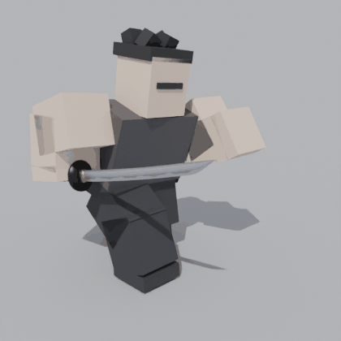
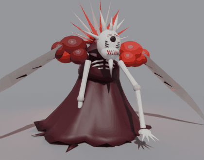
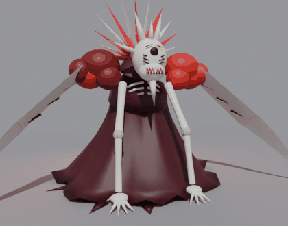

# Yami Sukehiro – Karanlık Büyü Yetenek Seti (Roblox)

Black Clover / Yami'nin karanlık büyüsü: simsiyah kılıç kombosu, **Kara Hilal**, **Ölüm Saplaması**, **Kara Koza**,
**Kara Kılıç** ve şarjlı **Boyut Kesiği** (gökyüzünde siyah yarık, yer yarılır, kayalar ve düşmanlar havalanır,
ekran sarsıntısı + manga darbe kareleri). Ayrıca **Kızıl Kemik İblisi** boss'u (Blender model + rig + animasyon,
düşük hasarlı saldırılar) ve TPS kontrolleri: **Shift** ile koşu (koşu animasyonu), **Ctrl** ile nişan kilidi.

- Hazır dosyalar: [`Roblox/`](Roblox) (`.rbxm` + demo `.rbxl`)
- Blender kaynakları: [`Blender/`](Blender) (`.blend`, FBX meshler, dokular, sesler)
- Önizlemeler: [`Previews/`](Previews)
- **Kurulum rehberi: [KURULUM.md](KURULUM.md)**

| Boyut Kesiği | Kara Hilal | Koşu |
|---|---|---|
|  |  |  |

| Boss yürüyüş | Boss yere vuruş | Boss kesik |
|---|---|---|
|  |  |  |

Kaynak kod `src/` içinde: Luau (`src/roblox`), Blender Python (`src/blender`), Rojo projeleri ve
`src/build_all.sh` (tüm dosyaları yeniden üretir).
