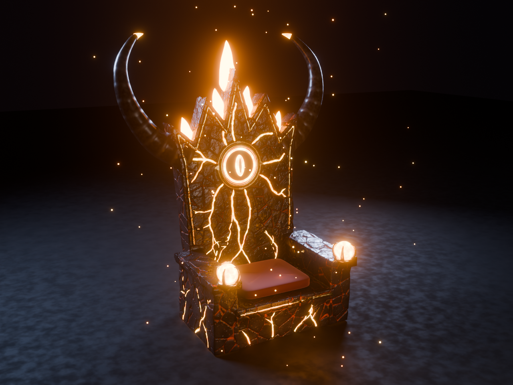
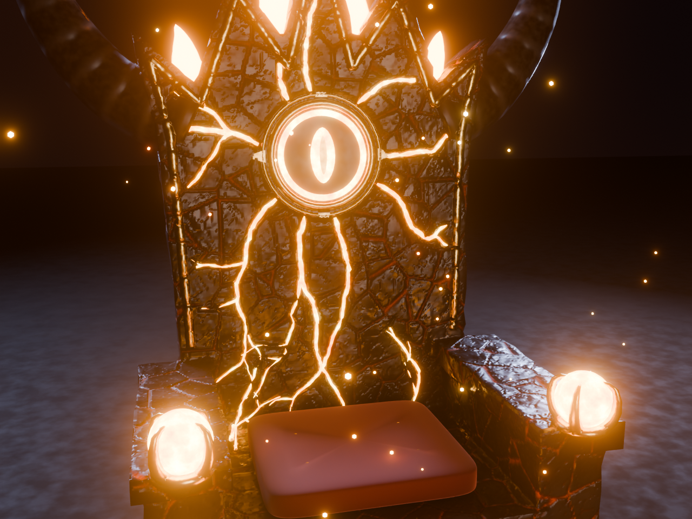
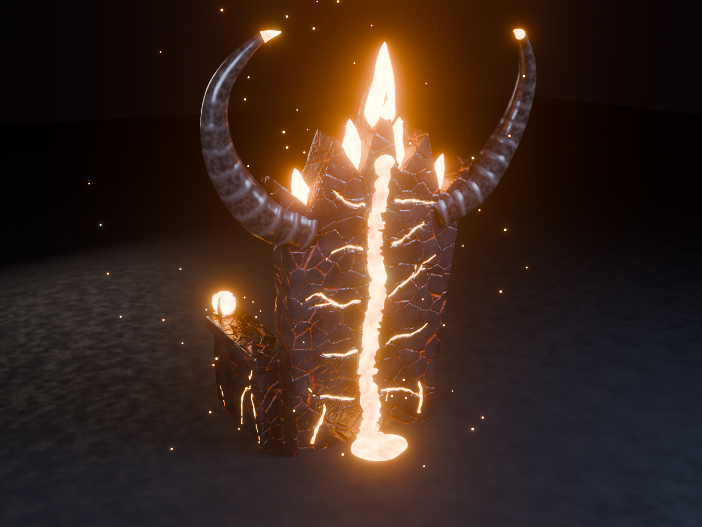
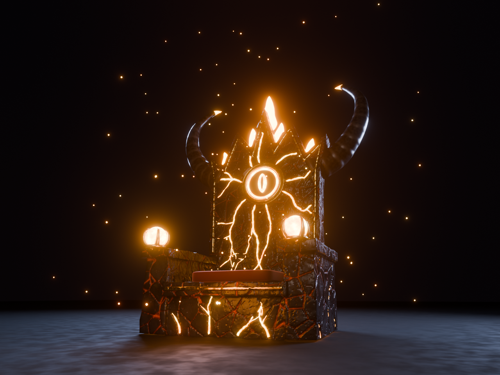

# Lav Tahtı (Lava Throne)

Obsidyen kayadan oyulmuş, içinden lav akan bir taht. `build_lava_throne.py` scripti ile üretiliyor.



| Yakın | Arka | Alt açı |
|---|---|---|
|  |  |  |

## Neler var
- **Gövde (`ThroneBody`):** Obsidyen taht. Sırtlıkta 5 sivri taç var. Ortada altın çerçeveli bir ejderha gözü rünü bulunuyor ve damarlar bu ründen dışarı yayılıyor. Kolçakların ucunda altın ejderha pençeleri lav kürelerini tutuyor. Yanlarda uçları kızgın lav gibi parlayan iki büyük boynuz var. Kenarları altın şeritlerle süslü.
- **Platform:** Çatlamış bazalt zemin. İçine oyulmuş 6 lav nehri, arkada bir lav havuzu, 4 köşede küçük volkan ağızları ve önde basamaklar var.
- **Lav şelalesi:** Sırtlığın arkasından aşağı akıp havuza dökülüyor.
- **6 magma kayası:** Tahtın etrafında süzülüyor.
- **Ateş tacı:** Taç uçlarının arasından yükselen 5 alev. Her alevin içinde ayrı bir sarı çekirdek var.
- **Kadife minder:** Bordo renkte, altın düğmeli.

## Dosyalar (`export/LavaThrone/`)
| Dosya | Açıklama |
|---|---|
| `LavaThrone.fbx` | Tüm parçalar, dokular gömülü olarak |
| `textures/ThroneBody_{Color,Normal,Roughness,Metalness}.png` | Gövde PBR dokuları, 1024×1024 |
| `textures/Platform_{Color,Normal,Roughness}.png` | Platform PBR dokuları, 1024×1024 |
| `textures/MagmaRock_{Color,Normal,Roughness}.png` | Kaya PBR dokuları, 512×512 |
| `LavaThrone.blend` | Önizleme animasyonlu sahne. Blender'da Space tuşuyla oynatılır. |
| `renders/*.png` | Önizleme renderları |

Ölçek 1 Blender birimi = 1 stud. Platform yaklaşık 14,5 stud genişliğinde, taht boynuzlarla birlikte yaklaşık 12 stud yüksekliğinde. Oturma yüksekliği zeminden yaklaşık 2 stud. Roblox'ta daha küçük istersen modeli seçip `Model:ScaleTo(0.75)` kullanabilirsin.

## Roblox Studio'ya kurulum
1. **İçe aktar:** Home → **Import 3D** → `LavaThrone.fbx`. Şu ayarları kullan:
   - **Import Only As Model** açık
   - **Anchored** açık
   - **Merge Meshes** kapalı. Hareketli parçalar ayrı kalmalı.
2. **Dokular (SurfaceAppearance):** `ThroneBody`, `Platform` ve `MagmaRock_1..6` parçalarının içine birer **SurfaceAppearance** ekle. Haritaları `textures/` klasöründen ata:
   - `ColorMap` → `*_Color.png`
   - `NormalMap` → `*_Normal.png`
   - `RoughnessMap` → `*_Roughness.png`
   - `MetalnessMap` → `ThroneBody_Metalness.png` (yalnızca gövde)

   PNG'leri **Asset Manager → Bulk Import** ile yükleyebilirsin. Importer bu dosyayı zaten oluşturduysa yalnızca haritaların doğru olduğunu kontrol et.
3. **Neon parçalar:** Aşağıdaki parçaların `Material` ayarını **Neon** yap ve rengini ver.

   | Parça | Renk (RGB) | Not |
   |---|---|---|
   | `LavaVeins_Front`, `LavaVeins_Back`, `LavaVeins_Base`, `HornTip_L/R` | 255, 110, 20 | |
   | `Lavafall`, `LavaPool`, `VentLava_1..4` | 255, 90, 10 | |
   | `LavaRivers` | 255, 80, 10 | |
   | `RuneGlow`, `ClawOrb_L/R` | 255, 170, 60 | |
   | `Flame_1..5` | 255, 85, 15 | Transparency 0.15 |
   | `FlameCore_1..5` | 255, 200, 90 | |
4. **Diğer parçalar:**
   - `Seat`: Material **Fabric**, renk 90, 5, 15.
   - `Seat_Buttons`: Material **Metal**, renk 230, 170, 70.
5. **Oturma:** `Seat` mesh'inin üstüne bir **Seat** parçası ekle. Aynı boyutta olsun ve `Transparency = 1` yap.
6. **Işık (renderdaki görünüm için önemli):**
   - `Lighting.Technology` = **Future**
   - `Lighting` içine bir **BloomEffect** ekle: Intensity 0.6, Size 30, Threshold 0.9
   - Ortam karanlık olsun: `Lighting.Ambient` ≈ 20, 15, 15
   - Tahtın önüne turuncu bir **PointLight** koy: Range 16, Brightness 2

## Hareketli parçalar
Roblox rig'siz FBX animasyonunu kullanamaz. Bu yüzden hareket eden her parça ayrı geliyor. Aşağıdaki hareketler `.blend` dosyasında önizleme olarak hazır. Roblox'ta `TweenService` ile yapılacak.

| Parça | Hareket | Pivot |
|---|---|---|
| `MagmaRock_1..6` | Tahtın etrafında yörünge, inip kalkma, kendi etrafında dönme | merkez (0, 0) |
| `Flame_*`, `FlameCore_*` | Boyu titreyerek uzar ve kısalır | alevin tabanı |
| Tüm Neon parçalar | Parlaklık nabız gibi atar. Roblox'ta Color tween'i ile yapılır. | |
| `RuneGlow`, `ClawOrb_*`, `HornTip_*` | Oturunca parlar | |
| `VentLava_*` | Oturunca lav fışkırtır. Buraya ParticleEmitter eklenir. | |

**Parçacık önerileri:**
- `VentLava_*` ve `LavaPool` üzerine Attachment ve ParticleEmitter ekle (kor, duman).
- Alevlerin üstüne `Fire` ekle.
- Tüm modele hafif turuncu bir kor ParticleEmitter ekle. Renderdaki uçuşan korlar yalnızca önizleme içindir, FBX'te yoktur.

## Yeniden üretme
```bash
python3 blender/build_lava_throne.py --render   # tam kalite (~10 dk, CPU)
python3 blender/build_lava_throne.py --quick    # hızlı deneme
```
Ayarlamak istersen:
- **Şekil:** `OUTLINE` (sırtlık konturu) ve `horn_points` (boynuz eğrisi).
- **Damar deseni:** `build_vein_nets`. `rng` tohumunu değiştirirsen farklı bir çatlak deseni çıkar.
- **Renkler:** `HEAT_STOPS` ve `*_material` fonksiyonları.

Script her parçayı Roblox'un 20.000 üçgen sınırına göre kontrol eder.
