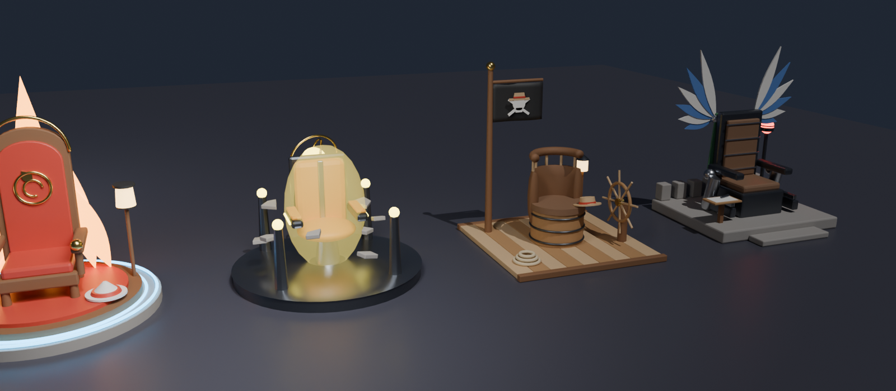

# Anime Koltukları (Blender → Roblox)

Bu klasörde oturulabilen 4 anime temalı koltuk var. Hepsi `build_chairs.py` scripti ile Blender'da üretiliyor.



| Dosya | Koltuk | Parça | Üçgen |
|---|---|---|---|
| `export/HokageThrone.fbx` | Hokage Tahtı (Naruto esintili) | 39 | ~6.700 |
| `export/GravityTrainingChair.fbx` | Gravite Eğitim Koltuğu (Dragon Ball esintili) | 37 | ~7.900 |
| `export/PirateCaptainChair.fbx` | Kaptan Koltuğu (One Piece esintili) | 38 | ~7.300 |
| `export/ScoutCommandChair.fbx` | Komuta Koltuğu (Attack on Titan esintili) | 42 | ~5.400 |
| `export/AnimeChairs.blend` | 4 koltuk yan yana, Blender'da oynatılabilen önizleme animasyonlarıyla | | |

Amblemler genel şekillerden oluşuyor, resmi logo kullanılmadı. Bu yüzden Roblox moderasyonuna takılmamaları gerekir.

## Roblox Studio'ya aktarma
1. **Home → Import 3D** ile `.fbx` dosyasını seç.
2. Ayarlar:
   - **Import Only As Model** açık.
   - **Anchored** açık.
   - **Merge Meshes** kapalı. Animasyonlu parçaların ayrı kalması gerekiyor.
3. Boyutu kontrol et. Ölçek 1 Blender birimi = 1 stud. Koltuklar yaklaşık 8 stud genişliğinde ve oturma yüksekliği ~2 stud. Çok küçük ya da çok büyük gelirse, Import penceresindeki **Scale** değerini değiştir (genelde 1 ya da 0.01).
4. **Oturma yeri:** MeshPart doğrudan oturulabilir olmaz. `Seat` adlı mesh'in içine bir **Seat** parçası ekle:
   - Aynı boyut ve konumda olsun.
   - `Transparency = 1` yap.
   - Mesh'i `CanCollide = false` bırakabilirsin.
5. **Neon parçalar:** Adı veya malzemesi `Neon_` ile başlayan parçaların `Material` ayarını **Neon** yap. DBZ koltuğundaki `Aura` için ayrıca **Transparency 0.7** ayarla.
6. **Sabitleme:** Hareket edecek parçaları `Anchored = false` yapıp gövdeye `WeldConstraint` ya da `HingeConstraint` ile bağla. Sadece tween ile hareket ettireceksen anchored bırakabilirsin.

## Animasyonlu parçalar (Roblox'ta script ile hareket edecek)
Roblox, rig'siz modellerin FBX animasyonunu kullanamaz. Bu yüzden hareket eden her parça ayrı bir obje olarak geliyor ve Roblox'ta `TweenService` ya da Constraint ile oynatılacak. Aşağıdaki hareketler `.blend` dosyasında önizleme olarak hazır, Blender'da Space tuşuyla izleyebilirsin.

| Koltuk | Parça | Hareket |
|---|---|---|
| Hokage | `ChakraRing_1`, `ChakraRing_2` | Döner ve büyüyerek yayılır |
| Hokage | `Flame_1..5` | Titreyerek uzayıp kısalır |
| Hokage | `Lantern_Glow_L/R` | Oturunca yanar |
| Gravite | `Debris_1..10` | Yerden havaya yükselir |
| Gravite | `KiOrbit_1/2` | Çekirdeğin etrafında döner |
| Gravite | `KiCore`, `Aura`, `Pylon_Orb_*`, `Floor_Glow` | Nabız gibi parlar |
| Kaptan | `Flag` | Direk etrafında sallanır (pivot direkte) |
| Kaptan | `Wheel` | Dümen döner (pivot göbekte) |
| Kaptan | `Lantern_Glow` | Oturunca yanar |
| Komuta | `Wing_L`, `Wing_R` | Arkadan dışarı açılır (pivot sırtlığın üst köşesinde) |
| Komuta | `Alarm_Light` | Kırmızı yanıp söner |

`Flag`, `Wheel` ve `Wing_*` parçalarının pivotu mentese noktasında. Roblox'ta `PivotTo` ya da `HingeConstraint` kullanırken bu nokta dönme merkezi olur.

## Yeniden üretme / değiştirme
```bash
pip install bpy                                  # ya da Blender 4.2+ yüklü olmalı
python3 blender/build_chairs.py                  # FBX + .blend üretir
python3 blender/build_chairs.py --render         # ayrıca export/renders/ altına PNG önizlemeleri üretir
blender --background --python blender/build_chairs.py   # Blender ile çalıştırma
```
Renkler `materials()` fonksiyonunda, her koltuğun şekli ise `build_*` fonksiyonlarında tanımlı. Script her parçayı Roblox'un 20.000 üçgen sınırına göre kontrol eder.
