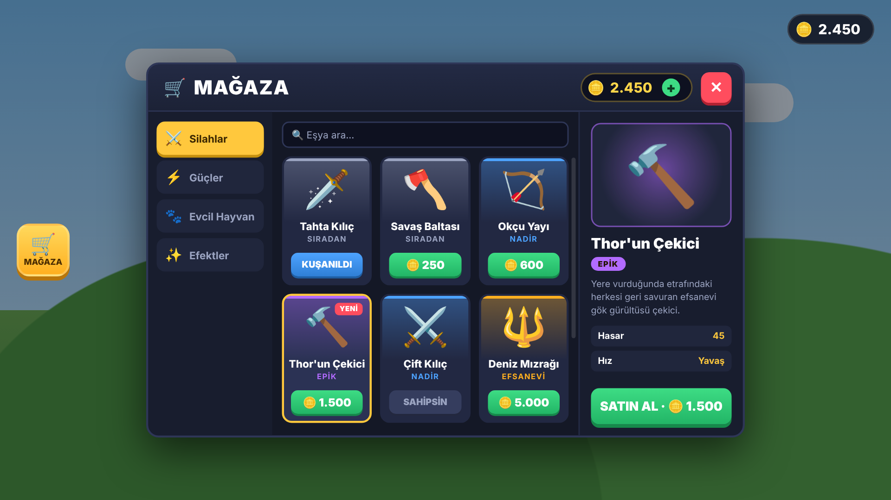
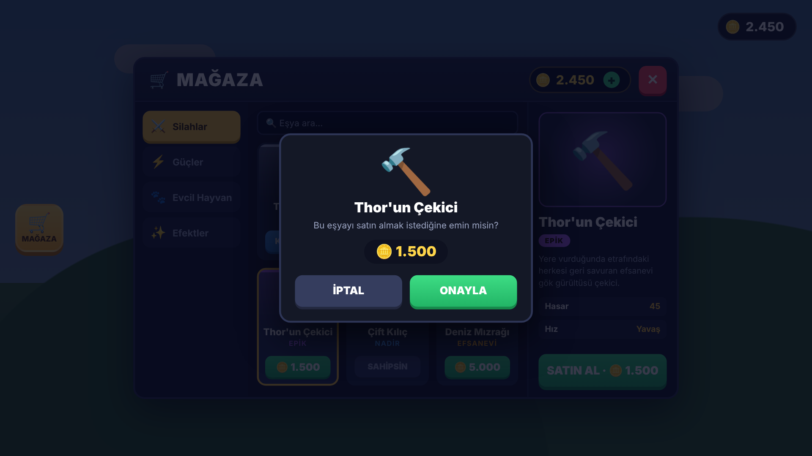
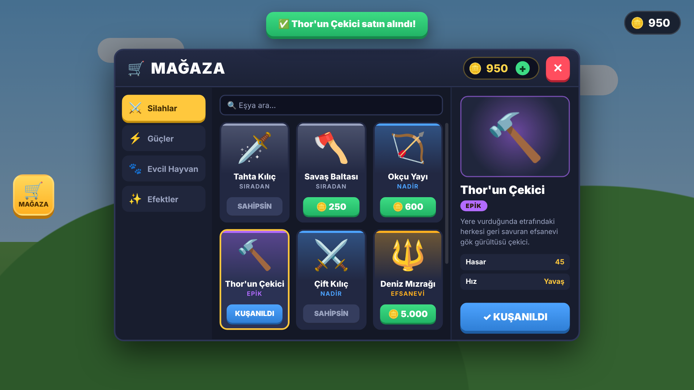

# Roblox Mağaza (Shop) GUI

Kategorili, arama kutulu, satın alma onaylı ve kayıtlı (DataStore) bir mağaza sistemi.
Arayüz tamamen kodla oluşturulur; Studio'da elle UI kurmana gerek yok.

| Ana ekran | Satın alma onayı | Satın alındı |
|---|---|---|
|  |  |  |

## Özellikler

- 4 kategori: **Silahlar, Güçler, Evcil Hayvan, Efektler** (20 hazır eşya)
- Nadirlik renkleri: Sıradan, Nadir, Epik, Efsanevi
- Eşya detay paneli, istatistikler, "YENİ" rozeti, arama kutusu
- Satın alma onay penceresi ve bildirimler
- Satın al / kuşan / çıkar (her kategoride 1 eşya kuşanılır)
- Güvenli: tüm kontroller sunucuda yapılır
- Coin'ler ve eşyalar DataStore ile kaydedilir
- Telefon ve tablette ekrana göre otomatik ölçeklenir
- **M** tuşu ya da soldaki 🛒 butonuyla açılır

Kuşanınca oyunda olanlar:

| Kategori | Ne olur |
|---|---|
| Silahlar | `ServerStorage/ShopTools` içindeki aynı isimli Tool çantaya verilir |
| Güçler | Yürüme hızı, zıplama gücü ya da coin çarpanı değişir |
| Evcil Hayvan | Karakterin yanında emoji evcil hayvan uçar |
| Efektler | Karaktere Fire / Sparkles / Smoke efekti eklenir |

## Kurulum (Roblox Studio)

1. **ReplicatedStorage** içine bir **ModuleScript** ekle, adını `ShopItems` yap,
   içine `src/ReplicatedStorage/ShopItems.lua` dosyasını yapıştır.
2. **ServerScriptService** içine bir **Script** ekle, adını `ShopServer` yap,
   içine `src/ServerScriptService/ShopServer.server.lua` dosyasını yapıştır.
3. **StarterPlayer > StarterPlayerScripts** içine bir **LocalScript** ekle, adını `ShopClient` yap,
   içine `src/StarterPlayerScripts/ShopClient.client.lua` dosyasını yapıştır.
4. (Silahlar için) **ServerStorage** içine `ShopTools` adında bir Folder aç ve
   Tool'larını eşya Id'leriyle adlandırarak içine koy: `WoodenSword`, `BattleAxe`,
   `HunterBow`, `ThorHammer`, `DualSwords`, `SeaTrident`.
5. Kayıt için: **Game Settings > Security > Enable Studio Access to API Services** seçeneğini aç
   (oyunun yayınlanmış olması gerekir).
6. Play'e bas.

Rojo kullanıyorsan `rojo serve` komutu `default.project.json` ile her şeyi doğru yere koyar.

## Özelleştirme

`ShopItems.lua` içinde:

- **Yeni eşya eklemek:** `Items` listesine bir satır ekle.
- **Emoji yerine resim:** eşyaya `Image = "rbxassetid://123456"` ekle.
- **Başlangıç parası / pasif gelir:** `Settings.StartingCoins`, `Settings.PassiveIncome`.
- **Robux ile coin satmak:** bir Developer Product oluştur, ID'sini `Settings.CoinProduct.Id` alanına yaz.
- **Coin ikonu kutucuk görünüyorsa:** `Settings.CoinIcon = "💰"` yap.

Renkleri değiştirmek için `ShopClient.client.lua` dosyasının başındaki `THEME` ve `STYLES` tablolarını düzenle.

Başka bir script'ten coin vermek için:

```lua
player.leaderstats.Coins.Value += 100
```

## Dosyalar

```
roblox-shop/
├── default.project.json          Rojo proje dosyası
├── gorseller/                    Tasarım görselleri
├── mockup/shop.html              Görsellerin üretildiği HTML taslak
└── src/
    ├── ReplicatedStorage/ShopItems.lua              Eşyalar ve ayarlar
    ├── ServerScriptService/ShopServer.server.lua    Sunucu (coin, satın alma, kayıt)
    └── StarterPlayerScripts/ShopClient.client.lua   Arayüz
```
