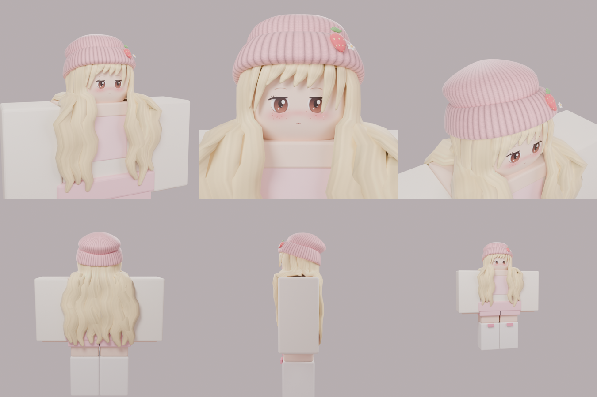

# Strawberry Beanie Set: Roblox UGC (Blender → Roblox Studio)

Referans görseldeki karakterin parçaları: pembe örgü bere (çilekli, çiçekli rozet), uzun dalgalı sarı saç, chibi kafa ve anime yüz. Hepsi Blender'da prosedürel olarak üretildi. Ayrıca Roblox Studio'da R15 bir kız rig'i oluşturup bu parçaları ona takan bir betik var.



## Klasörler

| Yol | İçerik |
|---|---|
| `blender/build_strawberry_set.py` | Her şeyi sıfırdan üreten Blender betiği (mesh, UV, doku, FBX, .blend, render) |
| `exports/SB_Head.fbx` | Kafa ve boyalı yüz, 3472 üçgen |
| `exports/SB_Hair.fbx` | Saç aksesuarı, 3826 üçgen |
| `exports/SB_Beanie.fbx` | Bere aksesuarı, 2364 üçgen |
| `exports/SB_HairBeanieCombo.fbx` | Saç ve bere tek aksesuarda, 3787 üçgen |
| `exports/StrawberrySet.blend` | Tüm sahne (dokular paketli, önizleme gövdesi ayrı koleksiyonda) |
| `exports/mesh_data.json` | Her mesh'in kafaya göre konumu ve boyutu (stud) |
| `textures/SB_HairBeanie_Atlas.png` | Saç ve berenin ortak 1024² dokusu |
| `textures/SB_Head_Face.png` | Kafa ve yüz dokusu, 1024² |
| `textures/SB_FaceDecal.png` | Klasik kafa için şeffaf yüz decal'i, 512² |
| `textures/SB_Shirt_Template.png` | Krem örgü kazak ve pembe fiyonklu üst (Classic Shirt, 585×559) |
| `textures/SB_Pants_Template.png` | Pembe etek ve fiyonklu beyaz tozluk (Classic Pants, 585×559) |
| `roblox/StrawberryGirl_Builder.lua` | Studio'da rig kurup aksesuarları takan betik |
| `previews/` | Cycles render önizlemeleri |

Bütün aksesuarlar Roblox'un 4.000 üçgen UGC sınırının altında. Her parça tek doku ve tek materyal kullanıyor.

## 1) Blender

Betiği yeniden çalıştırmak (Blender ≥ 4.2 veya `pip install bpy`):

```bash
python3 blender/build_strawberry_set.py          # pip ile kurulan bpy modülüyle
blender -b -P blender/build_strawberry_set.py    # veya Blender'ın kendisiyle
```

Ortam değişkenleri:
- `SB_RENDER=0`: render almaz.
- `SB_SAMPLES=24`: hızlı render.
- `SB_VIEWS=01,02`: yalnızca seçilen görünümler.
- `SB_OUT_DIR=...`: çıktı klasörü.

Betik **blender-mcp** (`execute_blender_code`) ile açık bir Blender'da da çalışır. Bu durumda yeni bir `StrawberrySet` sahnesi kurar ve kullanıcının açık dosyasının üzerine yazmaz.

Ölçek: 1 Blender birimi 1 stud'a karşılık gelir (Unit Scale 0.01, cm). Karakter Blender'da −Y yönüne bakıyor; FBX varsayılan ayarlarla (−Z forward, Y up) dışa aktarılıyor. Bu, Roblox'un beklediği yön.

## 2) Roblox Studio: rig kurma

1. **Avatar → Import 3D** ile `exports/` içindeki FBX'leri Workspace'e içe aktar. Dokular FBX'e gömülü olduğu için otomatik gelir.
2. İsteğe bağlı: `SB_Shirt_Template.png` ve `SB_Pants_Template.png` dosyalarını Asset Manager'dan yükle, ID'lerini betiğin başındaki `CONFIG` bölümüne yaz.
3. `roblox/StrawberryGirl_Builder.lua` dosyasının tamamını **View → Command Bar**'a yapıştırıp Enter'a bas. Roblox Studio MCP'nin `run_code` aracıyla da çalıştırabilirsin.

Betiğin yaptıkları:
- `StrawberryGirl` adında, ten rengi gövdeli bir R15 rig oluşturur.
- İçe aktarılan MeshPart'ları adlarına göre bulup `Accessory` olarak takar:
  - `SB_Head`: Face aksesuarı. Varsayılan kafa gizlenir.
  - `SB_Hair`: HairAttachment'a takılır.
  - `SB_Beanie`: HatAttachment'a takılır.
- Ek noktalarını (attachment) `MESH_DATA` değerlerinden hesaplar. Bu değerleri Blender betiği otomatik yazar. Bu sayede saç, bere ve kafa Blender'daki gibi hizalanır.
- İçe aktarma sırasında ölçek farkı olursa boyutu Blender değerine düzeltir.

`CONFIG` seçenekleri:
- `UseCombo = true`: saç ve bere tek aksesuar olarak takılır.
- `UseCustomHead = false`: varsayılan kafa ve `FaceDecalId` kullanılır.
- `Rotate180 = true`: içe aktarılan meshler ters bakıyorsa düzeltir.

## 3) Satışa koyma (UGC) notları

- **Saç ve bere**, rijit aksesuar olarak satılabilir. Studio'da **Avatar → Accessory Fitting Tool** ile aksesuarı seç ve Hair/Hat türünü ver, ardından **Validate** ile kontrol edip **Publish** et. UGC yüklemek için Roblox'ta kimlik doğrulama ve yayın ücreti gerekir.
- **Kafa ve yüz**, Roblox Marketplace'te yalnızca *Dynamic Head* olarak satılabilir. Bunun için FACS yüz rig'i (kemikler ve yüz ifadesi animasyonları) ve kafes (cage) gerekir. Buradaki `SB_Head` statik bir kafa ve boyalı yüzdür. Kendi oyunun ve rig'in için hazır durumda. Marketplace'e kafa olarak koymak için Blender'da FACS rig'i eklenmesi gerekir.
- Classic Shirt/Pants şablonları doğrudan Clothing olarak yüklenebilir.
