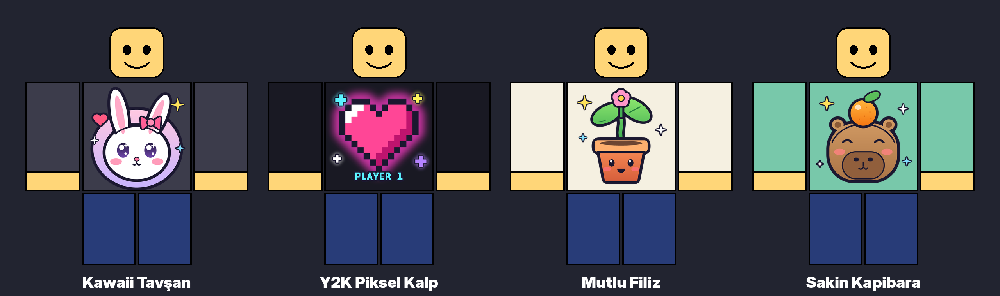
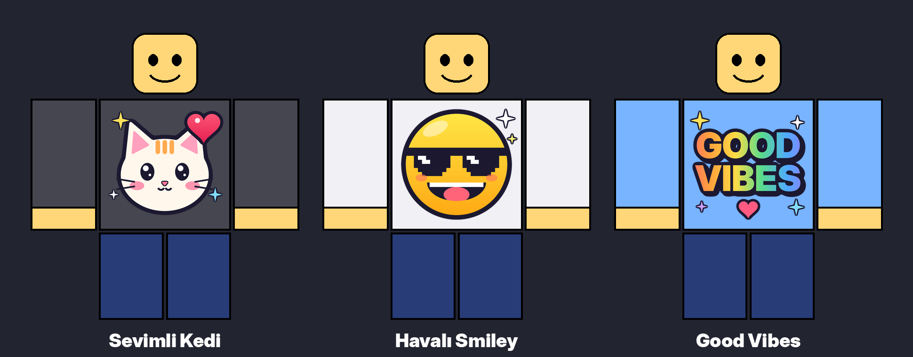
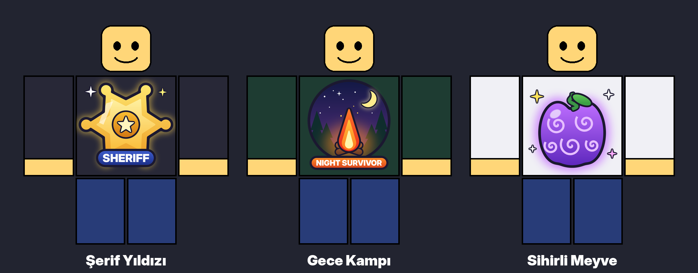
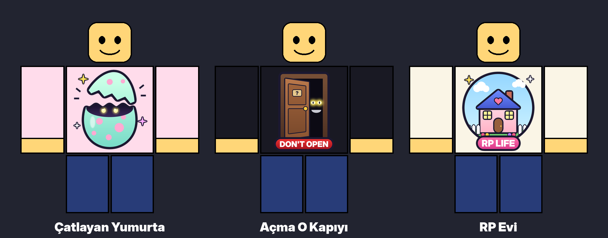

# Roblox T-Shirt Tasarımları

Hepsi **512x512, şeffaf arka planlı PNG**. Kalın koyu kontur sayesinde siyah, beyaz veya renkli her gömleğin üstünde görünür.

## Yeni seri (araştırmaya göre)

| Dosya | Neden satar |
|---|---|
| `4_kawaii_tavsan.png` | Sevimli hayvan tasarımlarında **tavşan 1. sırada**. Pastel renkli, sticker tarzı. |
| `5_y2k_piksel_kalp.png` | 2026'da **Y2K, piksel ve neon** tarzı yükselişte. Koyu gömleklerde parlar. |
| `6_mutlu_filiz.png` | **Grow a Garden** en çok oynanan oyun. Bahçe temasını telif sorunu olmadan kullanır. |
| `7_sakin_kapibara.png` | Viral kapibara meme'i: herkesin tanıdığı, her yaşa hitap eden bir tasarım. |

## İlk seri

| Dosya | Kime hitap eder |
|---|---|
| `1_sevimli_kedi.png` | Sevimli hayvanlarda 2. sıra. Her yaş, her cinsiyet. |
| `2_havali_smiley.png` | Meme / "cool" kitle. Küçük göründüğünde bile okunur. |
| `3_good_vibes.png` | Aesthetic / pozitif kitle. İngilizce olduğu için tüm dünyaya satılır. |

## Oyun temaları seri (en popüler Roblox oyunlarından esinlenen)

| Dosya | Esinlendiği oyun | Önerilen başlık |
|---|---|---|
| `8_serif_yildizi.png` | Murder Mystery 2 (Şerif rolü) | `Sheriff Badge Gold Star T-Shirt` |
| `9_gece_kampi.png` | 99 Nights in the Forest | `Night Survivor Campfire Forest T-Shirt` |
| `10_sihirli_meyve.png` | Blox Fruits | `Magic Swirl Fruit Power T-Shirt` |
| `11_catlayan_yumurta.png` | Adopt Me / Steal an Egg | `Cute Hatching Egg Pet T-Shirt` |
| `12_acma_kapiyi.png` | Doors | `Don't Open The Door Scary Eyes T-Shirt` |
| `13_rp_evi.png` | Brookhaven RP | `RP Life Cute House Roleplay T-Shirt` |

**Dikkat:** Tasarımlarda oyun adı, logo veya karakter **yok**. Roblox, telifli içerik kullanan kıyafetleri reddeder ve hesaba uyarı verebilir. Başlıklara da oyun adı yazma: alakasız anahtar kelime eklemek Roblox kurallarına aykırı. Oyuncular temayı zaten tanır.

Bu seriyi yeniden üretmek için `python3 oyun_temalari.py` komutunu çalıştır.

## 2026 kuralları (önemli)
- Her T-shirt yüklemesi **10 Robux**. Tasarım reddedilirse para iade edilmez.
- Satış yapmak için **Roblox Premium** gerekiyor.
- Her satıştan **%70** sana kalır. En düşük fiyat 5 Robux.
- Başka oyunların logosu, marka logoları veya kopya tasarımlar reddedilir. Bu yüzden tasarımlarda hiç logo yok.

## Satış ipuçları
1. Fiyatı **5 Robux** yap. Ucuz T-shirt'ler çok daha fazla satar.
2. Başlığa aranan kelimeleri yaz: `Cute Bunny ❤️ Kawaii Pastel Aesthetic T-Shirt`, `Capybara Orange Meme T-Shirt`, `Y2K Pixel Heart Neon`.
3. İlk olarak tavşan, kapibara ve kedi tasarımlarını yükle. Bunlar en geniş kitleye hitap ediyor.
4. Kendi giy ve popüler oyunlarda dolaş. Diğer oyuncular tasarımına tıklayıp satın alabilir.

## Yükleme
create.roblox.com > Creations > Avatar Items > **T-Shirt** > görseli yükle > onay sonrası satışa aç.

Tasarımları değiştirmek için `python3 olustur.py` komutunu çalıştır (Pillow gerekir).
